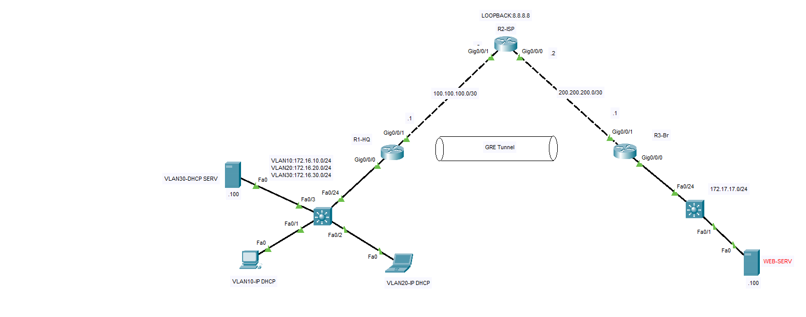
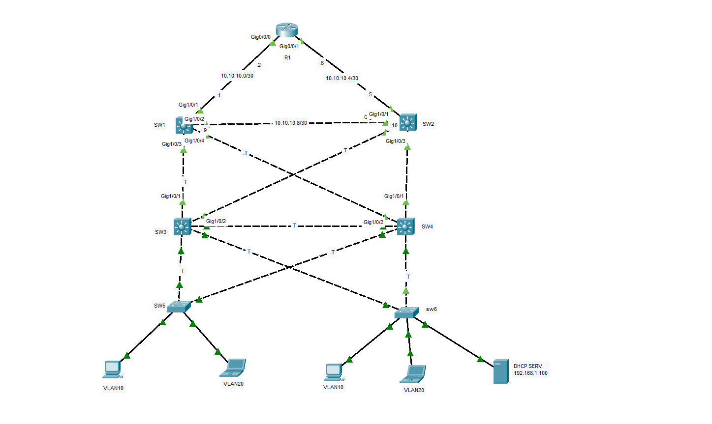
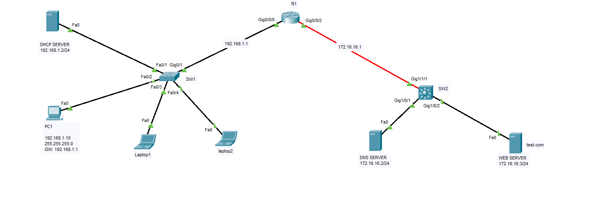

# Cisco Packet Tracer Network Projects

این مخزن شامل مجموعه‌ای از پروژه‌های شبیه‌سازی و پیکربندی شبکه است که با استفاده از نرم‌افزار **Cisco Packet Tracer** پیاده‌سازی شده‌اند.

---

## 📁 لیست پروژه‌ها

### پروژه ۱: GRE Tunnel و ISP
- **فایل:** `01-packet-tracer-project.pkt`
- **توضیحات:** پیاده‌سازی تونل GRE بین دو روتر (HQ و Branch)، شبیه‌سازی روتر ISP، پیکربندی VLAN و ارتباط با سرور وب.
- **تصویر توپولوژی:**
  

---

### پروژه ۲: VLAN و DHCP
- **فایل:** `02-packet-tracer-project.pkt`
- **توضیحات:** پیاده‌سازی شبکه بزرگ با چندین سوییچ، پیکربندی VLAN (VLAN10 و VLAN20)، راه‌اندازی DHCP Server و ارتباط بین شبکه‌ها.
- **تصویر توپولوژی:**
  

---

### پروژه ۳: روتینگ پایه (Basic Routing)
- **فایل:** `03-packet-tracer-project.pkt`
- **توضیحات:** اتصال دو شبکه مجزا با استفاده از یک روتر (R1)، پیکربندی آدرس‌دهی IP و روتینگ بین شبکه‌ها.
- **تصویر توپولوژی:**
  

---

## 🛠 مهارت‌های استفاده شده
- پیکربندی روترها و سوییچ‌های سیسکو
- آدرس‌دهی IPv4 و Subnetting
- VLAN، Trunking و Inter-VLAN Routing
- DHCP و GRE Tunnel
- روتینگ و اتصال به شبکه‌های خارجی

## 📝 نحوه اجرا
برای مشاهده و اجرای پروژه‌ها، به نرم‌افزار **Cisco Packet Tracer** نیاز دارید. کافی است فایل‌های `.pkt` را دانلود کرده و در برنامه باز کنید.
